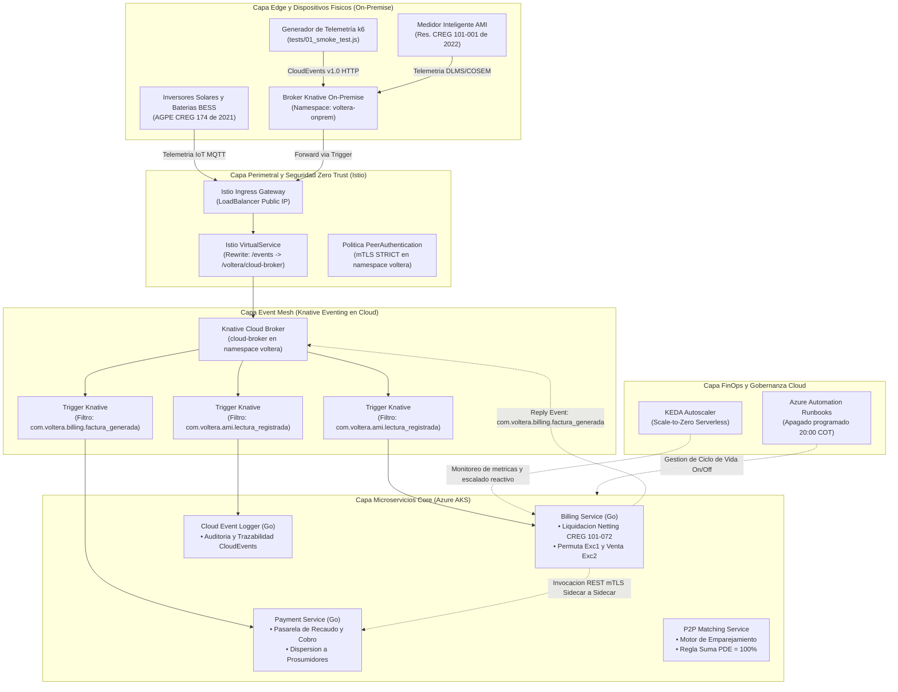
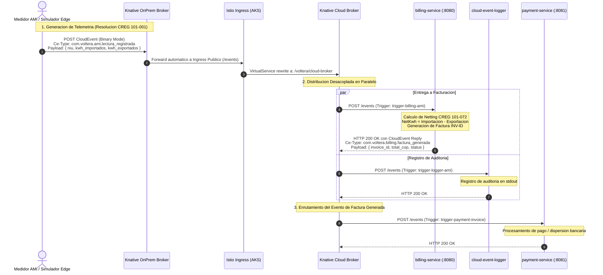
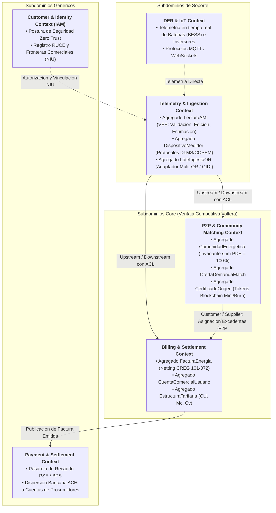
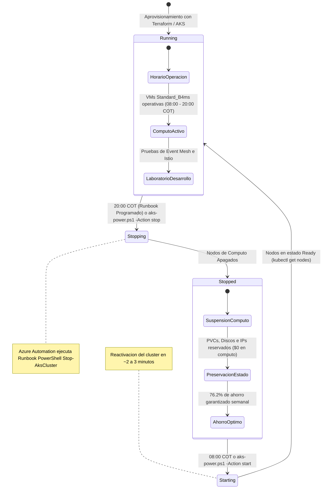

# Voltera - Plataforma Cloud-Native & Event Mesh Híbrido (Energytech)

Repositorio central del proyecto **Voltera** para la maestría en Arquitectura de TI (**ARTI4208** - Universidad de los Andes).

Voltera modela un ecosistema de comercialización digital de energía, transacciones P2P para Comunidades Energéticas y medición avanzada (AMI) bajo el marco regulatorio colombiano:
* **Resolución CREG 101-001 de 2022**: Infraestructura de Medición Avanzada (AMI) y telemetría horaria/cuarto-horaria.
* **Resolución CREG 174 de 2021**: Integración de Autogeneración a Pequeña Escala (AGPE) y Generación Distribuida.
* **Resolución CREG 101-072 de 2025**: Autogeneración Colectiva (AC), Comunidades Energéticas (CE), regla de asignación de excedentes ($\sum PDE = 100\%$) y liquidación Netting ($Exc_1$ permuta 1:1 y $Exc_2$ valorado al costo medio $Mc$).

---

## 🏛️ 1. Arquitectura del Ecosistema Voltera

### 1.1 Diagrama de Arquitectura de Alto Nivel

El siguiente modelo ilustra la interacción integral entre la capa de medición y dispositivos (Edge/On-Premise), la capa de seguridad perimetral Zero Trust, el Event Mesh con Knative Eventing, los microservicios core en la nube y los mecanismos de escalabilidad y FinOps.



---

### 1.2 Topología del Event Mesh Híbrido (Edge-to-Cloud)

Interconexión desacoplada mediante el estándar **CloudEvents v1.0** (HTTP Binary Mode) entre el plano de medición en el borde y el clúster en la nube:

```mermaid
flowchart LR
    subgraph RegionEdge["Region Edge / On-Premise (Subestacion / Medidores)"]
        Sim["Generador de Carga k6<br/>(tests/01_smoke_test.js)"]
        MockGo["Mock AMI Service (Go)<br/>(Puerto 8080)"]
        BrokerLocal["Knative OnPrem Broker<br/>(ns: voltera-onprem)"]
        TriggerEdge["Trigger Knative<br/>(trigger-forward-ami-to-cloud)"]
    end

    subgraph TransportNetwork["Transporte y Perimetro de Red"]
        Internet["Canal Seguro HTTPS / mTLS"]
        IstioGateway["Istio Ingress Gateway<br/>(Puerto 80 / LoadBalancer)"]
        VirtualSvc["VirtualService Ingress<br/>(/events -> rewrite a broker)"]
    end

    subgraph RegionCloud["Region Cloud: Azure AKS (ns: voltera)"]
        CloudBroker["Knative Cloud Broker<br/>(cloud-broker)"]
        
        subgraph SubTriggers["Triggers Knative con Filtro por Ce-Type"]
            T1["trigger-billing-ami<br/>com.voltera.ami.lectura_registrada"]
            T2["trigger-logger-ami<br/>com.voltera.ami.lectura_registrada"]
            T3["trigger-payment-invoice<br/>com.voltera.billing.factura_generada"]
        end
        
        subgraph Consumers["Microservicios Suscriptores"]
            Billing["billing-service:8080<br/>URI: /events"]
            Logger["cloud-event-logger:80<br/>(Event Display Pod)"]
            Payment["payment-service:8081<br/>URI: /events"]
        end
    end

    Sim -->|POST CloudEvent| BrokerLocal
    MockGo -->|POST CloudEvent| BrokerLocal
    BrokerLocal --> TriggerEdge
    TriggerEdge -->|HTTP Binary Mode| Internet
    Internet --> IstioGateway
    IstioGateway --> VirtualSvc
    VirtualSvc --> CloudBroker

    CloudBroker --> T1
    CloudBroker --> T2
    CloudBroker --> T3

    T1 --> Billing
    T2 --> Logger
    T3 --> Payment

    Billing -.->|Knative Event Reply| CloudBroker
```



---

### 1.3 Diagrama de Secuencia: Flujo End-to-End de Telemetría y Facturación

El siguiente diagrama detalla la traza completa de un evento: desde su emisión en el medidor hasta el cobro o dispersión bancaria, incluyendo el patrón **Event Reply** de Knative y la observabilidad distribuida.



---

### 1.4 Modelo Estratégico DDD: Bounded Contexts y Context Map

Diseño de arquitectura guiado por el dominio (*Domain-Driven Design*), delimitando responsabilidades de negocio, agregados e integraciones mediante capas anticorrupción (ACL):



---

### 1.5 Ciclo de Vida FinOps: Ahorro Automatizado en AKS

Estrategia de optimización de costos en Azure Kubernetes Service orientada a maximizar el rendimiento de créditos de desarrollo:



---

## 🗂️ 2. Estructura del Repositorio Organizado

```
nuevagen/
├── src/services/             # Microservicios Go modularizados con soporte CloudEvents
│   ├── README.md             # 📘 Especificación y modelos de microservicios Go
│   ├── build-images.ps1      # Compilación automatizada de imágenes Docker
│   ├── billing-service/      # Liquidación Netting CREG 101-072 (/invoice, /events, /health)
│   └── payment-service/      # Pasarela de pagos y dispersión (/process, /events, /health)
├── tests/                    # 🧪 Suite de pruebas funcionales, de escenarios y carga (k6)
│   ├── README.md             # 📘 Guía completa y orden de ejecución
│   ├── 01_smoke_test.js      # Paso 01: Humo y conectividad de telemetría (CloudEvents)
│   ├── 02_prosumer_scenario.js # Paso 02: Escenario de prosumidor con alta inyección solar
│   ├── 03_load_test.js       # Paso 03: Pruebas de estrés y carga masiva concurrente
│   └── utils.js              # Módulo auxiliar (payloads AMI y headers CloudEvents)
├── mock-onprem/              # Emulador Edge/On-Premise de Medidores Inteligentes (AMI)
│   ├── README.md             # 📘 Guía y modelos del emulador Edge
│   ├── main.go               # Servicio receptor/emisor HTTP CloudEvents
│   ├── Dockerfile
│   └── k8s/                  # Broker local OnPrem y reenvío automático al Cloud
│       ├── app.yaml
│       └── trigger-to-cloud.yaml
├── k8s/                      # Manifiestos de Kubernetes para la Región Cloud (AKS)
│   ├── README.md             # 📘 Arquitectura de despliegue, Zero Trust y Knative Mesh
│   ├── knative-event-mesh.yaml # Broker Knative, Triggers por tipo de evento e Ingress Istio
│   ├── billing.yaml          # Despliegue del microservicio de facturación
│   ├── payment.yaml          # Despliegue del microservicio de pagos
│   ├── namespace.yaml        # Namespace 'voltera' con Istio Injection habilitado
│   └── istio-auth-policy.yaml# Políticas Zero Trust y mTLS STRICT
├── infra/                    # Infraestructura como Código (IaC) y entornos de despliegue
│   ├── README.md             # 📘 Portal central de infraestructura (Azure Cloud & Local Edge)
│   ├── manage.ps1            # ⚡ CLI unificado PowerShell para gestionar local, azure y addons
│   ├── manage.sh             # ⚡ CLI unificado Bash para Linux y macOS
│   ├── azure-terraform/      # ☁️ CLOUD CORE: IaC para AKS B4ms, APIM, Event Grid y FinOps
│   │   ├── README.md         # 📘 Guía de recursos Azure y ahorro FinOps (~76%)
│   │   ├── environments/dev/ # Entorno Dev configurado en East US 2 (con terraform.tfvars.example)
│   │   ├── modules/          # Módulos: aks, apigateway, eventgrid, finops_automation, etc.
│   │   └── scripts/          # aks-power.ps1 (Control On/Off de AKS para FinOps)
│   ├── local-k3s/            # 💻 EDGE / LOCAL: Clúster K3s con k3d en Docker Desktop
│   │   ├── README.md         # 📘 Guía de aprovisionamiento del clúster local Edge
│   │   ├── setup-k3s.ps1     # Script de inicio / creación del clúster k3d
│   │   └── teardown-k3s.ps1  # Script de detención / eliminación del clúster
│   └── addons/               # 🧩 ADDONS: Componentes Kubernetes Cloud-Agnósticos
│       ├── README.md         # 📘 Guía de instalación de Istio, Knative y KEDA
│       ├── versions.env      # Versiones fijadas dinámicas
│       ├── install.ps1       # Script de instalación unificada (Azure / Local) en PowerShell
│       └── install.sh        # Script de instalación unificada (Azure / Local) en Bash
└── docs/                     # Documentación técnica, modelos y diseño de arquitectura
    ├── EVENT_MESH.md              # 📡 Guía completa y especificación técnica del Event Mesh
    ├── FINOPS_AKS.md              # 💰 Manual de FinOps y control On/Off de AKS en Dev
    ├── IDEMPOTENCY_EXPERIMENT.md  # Experimento de Idempotencia (Material ARTI4208)
    ├── architecture/         # Modelos ArchiMate organizados (.archimate)
    │   ├── voltera.archimate
    │   └── voltera_bk.archimate
    ├── models/               # Modelos DDD (PlantUML, diagramas PNG/SVG y especificaciones)
    │   ├── poc_voltera_event_mesh.md
    │   ├── servicios_voltera_especificacion.md
    │   ├── voltera_ddd_bounded_contexts.puml
    │   └── voltera_ddd_bounded_contexts.png
    ├── Voltera_ARTI4208_Proyecto.md
    └── Voltera_ARTI4208_Proyecto.pdf
```

---

## Experimento de Idempotencia

Este repositorio incluye un **experimento de idempotencia** que demuestra cómo implementar procesamiento idempotente en arquitecturas dirigidas por eventos, siguiendo los principios del material ARTI4208 de Universidad de los Andes.

### Objetivo del Experimento
Demostrar que un sistema puede procesar eventos duplicados (10% del total) y garantizar que cada `matchId` único se procese **una sola vez**, sin consultas síncronas al productor.

### Quick Start

```bash
# 1. Validar prerequisitos
./scripts/idempotency/validate-setup.sh

# 2. Desplegar infraestructura
./scripts/idempotency/deploy-idempotency-lab.sh

# 3. Ejecutar demo completo
./scripts/idempotency/demo-idempotency.sh
```

**Resultado esperado**: 900 eventos únicos procesados de 1000 enviados, 0 duplicados en base de datos.

### Documentación
- 📖 **Documentación completa**: [docs/IDEMPOTENCY_EXPERIMENT.md](docs/IDEMPOTENCY_EXPERIMENT.md)
- ⚡ **Quick start**: [docs/QUICKSTART_IDEMPOTENCY.md](docs/QUICKSTART_IDEMPOTENCY.md)
- 🧪 **Test de idempotencia**: [tests/04_idempotency_test.js](tests/04_idempotency_test.js)

### Arquitectura del Experimento

```
Test k6 (1000 eventos: 900 únicos + 100 duplicados)
           ↓
    Knative Event Mesh
           ↓
  match-processor Service
  ✓ Deduplicación por matchId
  ✓ Caché Redis (fast path)
  ✓ PostgreSQL (persistent path)
  ✓ Transacción atómica
           ↓
  PostgreSQL: 900 registros únicos ✅
```

### Criterios de Éxito
- ✅ Un solo efecto por `matchId`
- ✅ 0 duplicados en estado final
- ✅ Procesamiento autónomo (sin consultas síncronas)
- ✅ Conforme a material ARTI4208 UniAndes


---

## ⚡ 3. Enlaces Rápidos y Guías Clave

### 📡 3.1 Proceso del Event Mesh Híbrido
* **Documentación técnica**: [docs/EVENT_MESH.md](docs/EVENT_MESH.md)
* **Resumen técnico**: Interconexión desacoplada mediante estándar **CloudEvents v1.0** entre la región Edge (`mock-onprem`) y el Cloud Core (`Azure AKS`).
* **Enrutamiento**: 
  - `com.voltera.ami.lectura_registrada` $\rightarrow$ Knative Broker $\rightarrow$ `billing-service` & `cloud-event-logger`.
  - `com.voltera.billing.factura_generada` $\rightarrow$ Knative Broker $\rightarrow$ `payment-service`.
* **Prueba rápida desde consola con k6**:
  ```powershell
  k6 run tests/01_smoke_test.js -e TARGET_URL="https://voltera-dev-mesh.eastus2.cloudapp.azure.com/events" -e COUNT=5
  ```

---

### 💰 3.2 Control On/Off de AKS para FinOps en Dev
* **Documentación técnica**: [docs/FINOPS_AKS.md](docs/FINOPS_AKS.md)
* **Objetivo**: Ahorrar entre el **75% y 80%** del consumo de créditos en Azure suspendiendo el cómputo de la máquina virtual `Standard_B4ms` fuera del horario de trabajo.
* **Control rápido con PowerShell**:
  ```powershell
  # Vía CLI unificado (Recomendado):
  pwsh .\infra\manage.ps1 azure status
  pwsh .\infra\manage.ps1 azure stop     # Detener cómputo ($0 USD)
  pwsh .\infra\manage.ps1 azure start    # Reanudar desarrollo

  # O mediante el script especializado:
  pwsh -File .\infra\azure-terraform\scripts\aks-power.ps1 -Action status
  pwsh -File .\infra\azure-terraform\scripts\aks-power.ps1 -Action stop
  pwsh -File .\infra\azure-terraform\scripts\aks-power.ps1 -Action start
  ```
* **Automatización Programada**: El módulo `infra/azure-terraform/modules/finops_automation` tiene activo un horario de apagado diario automático a las **20:00 (8:00 PM hora Bogotá)** mediante Azure Automation Runbooks.

---

## 🛠️ 4. Tecnologías y Estándares

| Área | Tecnología | Versión / Especificación | Propósito en el Proyecto |
|---|---|---|---|
| **Orquestación Cloud** | Azure Kubernetes Service (AKS) | Kubernetes 1.30+ | Cómputo principal de microservicios y Event Mesh |
| **Orquestación Edge / Local** | K3s (vía k3d en Docker Desktop) | v1.30.5+k3s1 | Emulación local de subestaciones y medidores AMI |
| **Service Mesh & Zero Trust** | Istio | 1.24 (Minimal Profile) | mTLS estricto, Ingress Gateway y políticas de autorización |
| **Event Mesh** | Knative Eventing | 1.16 | Broker multi-tenant, Triggers declarativos y filtros de evento |
| **Serverless & Autoscaling** | Knative Serving & KEDA | 1.16 / 2.16 | Escalado a cero (*scale-to-zero*) basado en eventos y métricas |
| **Estándar de Eventos** | CNCF CloudEvents | v1.0 (Binary HTTP Mode) | Formato agnóstico e interoperable de mensajería |
| **Lenguajes de Desarrollo y Pruebas** | Go & JavaScript (k6) | Go 1.22 / k6 (ES6) | Microservicios de alto rendimiento y suite de pruebas/carga AMI |
| **Infraestructura como Código** | Terraform | 1.9+ | Aprovisionamiento automatizado modular multi-nube |
