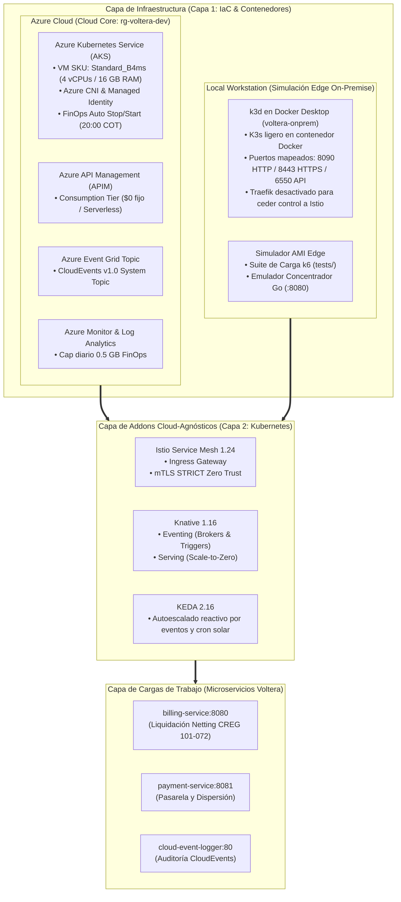

# Infraestructura de Voltera (Azure Cloud & Local Edge)

Este directorio centraliza la **Infraestructura como Código (IaC)** y la capa de orquestación de **Voltera**, organizada de forma desacoplada en dos entornos complementarios junto a una capa común de extensiones cloud-agnósticas:

1. ☁️ **Azure Cloud ([`azure-terraform/`](file:///d:/uniandes_local/nuevagen/infra/azure-terraform))**: Región Cloud Core oficial de desarrollo y producción. Aprovisiona un clúster gestionado **Azure Kubernetes Service (AKS)** con pasarela APIM, Event Grid y automatización **FinOps** para suspender el cómputo fuera de horario laboral (~76% de ahorro).
2. 💻 **Local / Edge Workstation ([`local-k3s/`](file:///d:/uniandes_local/nuevagen/infra/local-k3s))**: Clúster local K3s ejecutado sobre **k3d en Docker Desktop** para simular la región On-Premise, medidores inteligentes (AMI) y desarrollo rápido sin costo alguno en la nube.
3. 🧩 **Addons Cloud-Agnósticos ([`addons/`](file:///d:/uniandes_local/nuevagen/infra/addons))**: Capa de servicios comunes (**Istio**, **Knative Serving/Eventing**, **KEDA**) 100% reutilizable tanto en AKS como en el clúster local.
4. ⚡ **CLI Unificado ([`manage.ps1`](file:///d:/uniandes_local/nuevagen/infra/manage.ps1) / [`manage.sh`](file:///d:/uniandes_local/nuevagen/infra/manage.sh))**: Interfaz central de comandos para gestionar el ciclo de vida de ambos entornos de forma rápida y sencilla.

---

## ⚡ 1. Comandos Rápidos (Cheat Sheet)

| Tarea | PowerShell (Windows) | Bash (Linux / macOS) |
|---|---|---|
| **Ver ayuda y opciones** | `pwsh .\infra\manage.ps1 help` | `./infra/manage.sh help` |
| **Iniciar clúster local Edge** | `pwsh .\infra\manage.ps1 local start` | `./infra/manage.sh local start` |
| **Pausar clúster local (liberar RAM)** | `pwsh .\infra\manage.ps1 local stop` | `./infra/manage.sh local stop` |
| **Instalar Add-ons en Local K3s** | `pwsh .\infra\manage.ps1 local addons` | `./infra/manage.sh local addons` |
| **Consultar estado FinOps de AKS** | `pwsh .\infra\manage.ps1 azure status` | `./infra/manage.sh azure status` |
| **Encender clúster AKS en Azure** | `pwsh .\infra\manage.ps1 azure start` | `./infra/manage.sh azure start` |
| **Apagar clúster AKS ($0 USD cómputo)**| `pwsh .\infra\manage.ps1 azure stop` | `./infra/manage.sh azure stop` |
| **Conectar `kubectl` a Azure AKS** | `pwsh .\infra\manage.ps1 azure connect` | `./infra/manage.sh azure connect` |
| **Instalar Add-ons en Azure AKS** | `pwsh .\infra\manage.ps1 azure addons` | `./infra/manage.sh azure addons` |

---

## 🏛️ 2. Matriz de Arquitectura de Infraestructura



---

## 📊 3. Cuadro Comparativo: Azure AKS vs Local k3d

| Característica | ☁️ Azure Cloud ([`azure-terraform/`](file:///d:/uniandes_local/nuevagen/infra/azure-terraform)) | 💻 Local Workstation ([`local-k3s/`](file:///d:/uniandes_local/nuevagen/infra/local-k3s)) |
|---|---|---|
| **Rol en el Ecosistema** | **Cloud Core** (Región central de liquidación y facturación) | **Edge / On-Premise** (Emulación de subestación y medidores AMI) |
| **Tecnología K8s** | Azure Kubernetes Service (AKS) | K3s ejecutado en Docker Desktop vía k3d |
| **Cómputo** | 1 nodo `Standard_B4ms` (4 vCPUs, 16 GB RAM) | Cómputo local de la estación de trabajo |
| **Arquitectura CPU** | x86_64 (AMD64) | Nativa del Host (x86_64 / ARM64 Apple Silicon) |
| **Modelo de Costos** | Créditos Azure (Ahorro ~76% con FinOps nocturno) | **$0 USD** (100% local, funciona sin internet) |
| **Control de Energía** | Azure Automation Runbooks + `manage.ps1 azure start/stop` | `manage.ps1 local start/stop/delete` |
| **Ingress y Dominio** | Istio Ingress con Service `LoadBalancer` (IP pública Azure) | Istio Ingress en puerto `8090` (`127.0.0.1.sslip.io`) |

---

## 📁 4. Estructura Organizada del Directorio `infra/`

```
infra/
├── README.md                      # 📘 (Este documento) Portal y matriz de infraestructura
├── manage.ps1                     # ⚡ CLI Unificado PowerShell para Windows
├── manage.sh                      # ⚡ CLI Unificado Bash para Linux / macOS
├── .gitignore                     # Reglas de exclusión para tfstate, tfvars y secrets
│
├── azure-terraform/               # ☁️ PROVEEDOR CLOUD: Terraform para Microsoft Azure
│   ├── README.md                  # 📘 Documentación de AKS, APIM, Event Grid y FinOps
│   ├── environments/dev/          # Definición y variables del entorno dev (East US 2)
│   │   ├── main.tf                # Orquestación de módulos
│   │   ├── variables.tf           # Declaración de variables y cuotas FinOps
│   │   ├── terraform.tfvars.example # Plantilla sanitizada de configuración
│   │   ├── terraform.tfvars       # Valores locales del desarrollador (ignorado en git)
│   │   ├── outputs.tf             # Salidas y comandos de conexión
│   │   ├── providers.tf           # Configuración del proveedor azurerm
│   │   └── versions.tf            # Requisitos de versión de Terraform
│   ├── modules/                   # Módulos reutilizables:
│   │   ├── aks/                   # Clúster AKS Standard_B4ms y Azure CNI
│   │   ├── network/               # VNet (10.10.0.0/16) y Subred AKS
│   │   ├── finops_automation/     # Azure Automation Account, Runbooks On/Off y Schedule
│   │   ├── apigateway/            # Azure API Management (Consumption Tier Serverless)
│   │   ├── eventgrid/             # Azure Event Grid Topic (CloudEvents v1.0)
│   │   └── monitoring/            # Log Analytics Workspace (0.5 GB/día) y App Insights
│   └── scripts/
│       └── aks-power.ps1          # Control On/Off de AKS por Azure CLI
│
├── local-k3s/                     # 💻 ENTORNO LOCAL: Clúster K3s con k3d en Docker Desktop
│   ├── README.md                  # 📘 Guía de aprovisionamiento del clúster local Edge
│   ├── setup-k3s.ps1              # Script de inicio / creación del clúster k3d
│   └── teardown-k3s.ps1           # Script de detención / eliminación del clúster
│
└── addons/                        # 🧩 ADDONS: Componentes Kubernetes Cloud-Agnósticos
    ├── README.md                  # 📘 Guía de instalación de Istio, Knative y KEDA
    ├── versions.env               # Versiones exactas fijadas consumidas dinámicamente
    ├── install.ps1                # Script de despliegue automatizado para Windows
    ├── install.sh                 # Script de despliegue automatizado para Linux/macOS
    ├── istio/                     # Perfiles Istio (aks-values.yaml / values.yaml)
    ├── knative/                   # Knative Serving (net-istio) y Eventing Broker
    ├── keda/                      # KEDA Autoscaler y Metrics Server
    └── examples/                  # Manifiestos de prueba verificados:
        ├── hello-ksvc.yaml        # Knative Serving con Scale-to-Zero
        ├── event-display.yaml     # Knative Eventing Sink y PingSource
        └── keda-scaledobject.yaml # Autoescalado reactivo por CPU y cron solar CREG 174
```

---

## 🚀 5. Enlaces a las Guías Específicas

* ☁️ **Para desplegar en la nube (Azure AKS)**: Consulta [**`infra/azure-terraform/README.md`**](file:///d:/uniandes_local/nuevagen/infra/azure-terraform/README.md).
* 💻 **Para desplegar localmente (Docker / k3d)**: Consulta [**`infra/local-k3s/README.md`**](file:///d:/uniandes_local/nuevagen/infra/local-k3s/README.md).
* 🧩 **Para instalar los Addons de Kubernetes**: Consulta [**`infra/addons/README.md`**](file:///d:/uniandes_local/nuevagen/infra/addons/README.md).
