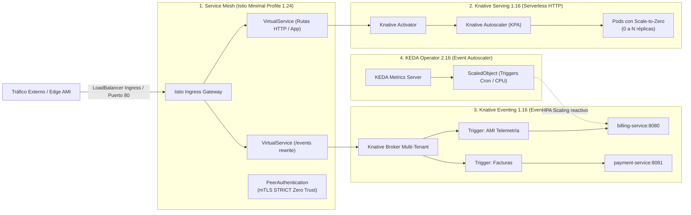

# Addons de Kubernetes Cloud-Agnósticos (Istio + Knative + KEDA)

Este directorio contiene los componentes de infraestructura de software (**Capa 2: Kubernetes**) que se instalan sobre cualquiera de los clústeres del proyecto (**Azure AKS** en la nube o **Local k3d** en el borde) de forma **100% agnóstica a la nube**.

---

## 🏛️ 1. Arquitectura del Stack de Addons



---

## 📁 2. Estructura de Componentes y Archivos

| Subdirectorio / Archivo | Versión Fijada | Función Arquitectónica |
|---|---|---|
| [`istio/`](file:///d:/uniandes_local/nuevagen/infra/addons/istio) | `1.24.2` | Perfil Minimal de Istio, Ingress Gateway ([`aks-values.yaml`](file:///d:/uniandes_local/nuevagen/infra/addons/istio/aks-values.yaml) para Azure y [`values.yaml`](file:///d:/uniandes_local/nuevagen/infra/addons/istio/values.yaml) para K3s local). |
| [`knative/`](file:///d:/uniandes_local/nuevagen/infra/addons/knative) | `v1.16.0` | Knative Serving ([`serving-config.yaml`](file:///d:/uniandes_local/nuevagen/infra/addons/knative/serving-config.yaml)) y Knative Eventing ([`eventing-broker.yaml`](file:///d:/uniandes_local/nuevagen/infra/addons/knative/eventing-broker.yaml)). |
| [`keda/`](file:///d:/uniandes_local/nuevagen/infra/addons/keda) | `2.16.0` | Operador KEDA para autoescalado horizontal reactivo basado en eventos y métricas horarias. |
| [`examples/`](file:///d:/uniandes_local/nuevagen/infra/addons/examples) | N/A | Manifiestos de prueba: [`hello-ksvc.yaml`](file:///d:/uniandes_local/nuevagen/infra/addons/examples/hello-ksvc.yaml), [`event-display.yaml`](file:///d:/uniandes_local/nuevagen/infra/addons/examples/event-display.yaml) y [`keda-scaledobject.yaml`](file:///d:/uniandes_local/nuevagen/infra/addons/examples/keda-scaledobject.yaml). |
| [`versions.env`](file:///d:/uniandes_local/nuevagen/infra/addons/versions.env) | N/A | Configuración centralizada de versiones consumida dinámicamente por los scripts de despliegue. |
| [`install.ps1`](file:///d:/uniandes_local/nuevagen/infra/addons/install.ps1) | PowerShell | Script automatizado para Windows con detección de entorno (`local`, `azure`) y cálculo de dominios sslip.io. |
| [`install.sh`](file:///d:/uniandes_local/nuevagen/infra/addons/install.sh) | Bash | Script automatizado para Linux/macOS con soporte de parámetros idéntico. |

---

## 🚀 3. Guía de Instalación Automatizada

### Opción A: Vía el Gestor Unificado (Recomendada)
```powershell
# Para instalar en Local K3s:
pwsh .\infra\manage.ps1 local addons

# Para instalar en Azure AKS:
pwsh .\infra\manage.ps1 azure addons
```

### Opción B: Ejecución Directa de Scripts

#### Para instalar en Azure AKS:
```powershell
pwsh -File .\infra\addons\install.ps1 -Target azure
```
O en Bash:
```bash
./infra/addons/install.sh --target azure
```

#### Para instalar en Local K3s (k3d):
```powershell
pwsh -File .\infra\addons\install.ps1 -Target local -PublicIp 127.0.0.1
```
O en Bash:
```bash
./infra/addons/install.sh --target local --public-ip 127.0.0.1
```

---

## 🧪 4. Pruebas de Verificación de los Addons

### 4.1 Probar Serverless con Scale-to-Zero (Knative Serving)
Despliega el servicio de prueba:
```powershell
kubectl apply -f infra/addons/examples/hello-ksvc.yaml
kubectl get ksvc hello
```
*El pod arrancará, responderá a peticiones y tras 30 segundos sin tráfico se apagará automáticamente a cero réplicas.*

### 4.2 Probar el Broker de Eventos (Knative Eventing)
```powershell
kubectl apply -f infra/addons/examples/event-display.yaml
kubectl get broker,trigger -n default
```
*El PingSource enviará un evento CloudEvent de prueba cada minuto hacia el Broker, el cual será entregado y registrado por el `event-display` pod.*

### 4.3 Probar Autoescalado Reactivo y Horario (KEDA)
```powershell
kubectl apply -f infra/addons/examples/keda-scaledobject.yaml
kubectl get scaledobject billing-service-scaler -n voltera
```
