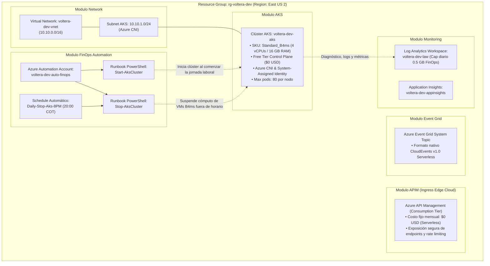
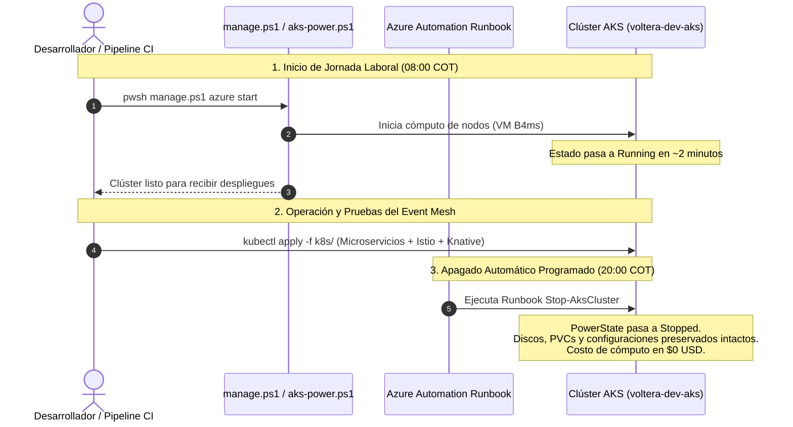

# Infraestructura como Código (IaC) para Azure AKS (Terraform)

Este módulo gestiona la infraestructura en la nube de **Microsoft Azure** para el entorno oficial de desarrollo (`voltera-dev`) en la región **East US 2**. Aprovisiona un clúster gestionado de **Azure Kubernetes Service (AKS)**, red virtual aislada, observabilidad, pasarela de APIs, Event Grid y automatización **FinOps** orientada a reducir el costo de cómputo en un **~76%**.

---

## 🏛️ 1. Arquitectura de Recursos en Azure

El entorno completo se encuentra confinado dentro del grupo de recursos `rg-voltera-dev`:



---

## 💰 2. Estrategia y Flujo de Automatización FinOps

Para maximizar el rendimiento de los créditos de la suscripción (ej. Visual Studio Enterprise), el clúster suspende sus nodos automáticamente durante noches y fines de semana:



---

## 📁 3. Organización del Directorio `azure-terraform/`

```
infra/azure-terraform/
├── README.md                      # 📘 (Este documento) Especificación y arquitectura Azure
├── environments/
│   └── dev/                       # Raíz de ejecución de Terraform para el entorno Dev
│       ├── main.tf                # Orquestador de llamadas a módulos
│       ├── variables.tf           # Declaración de variables y cuotas FinOps
│       ├── terraform.tfvars.example # Plantilla sanitizada de variables
│       ├── terraform.tfvars       # Valores locales activos (excluido en git)
│       ├── outputs.tf             # Salidas: Comandos de conexión, endpoints, etc.
│       ├── providers.tf           # Proveedor azurerm configurado
│       └── versions.tf            # Versión mínima de Terraform (>= 1.6) y azurerm
├── modules/
│   ├── aks/                       # Clúster AKS, pool de nodos Standard_B4ms y Azure CNI
│   ├── network/                   # Resource Group, VNet (10.10.0.0/16) y Subnet AKS
│   ├── finops_automation/         # Automation Account, Runbooks On/Off y Schedule nocturno
│   ├── apigateway/                # Azure API Management (Consumption Tier Serverless)
│   ├── eventgrid/                 # Azure Event Grid Topic (CloudEvents v1.0)
│   └── monitoring/                # Log Analytics Workspace (Cap 0.5 GB) y App Insights
└── scripts/
    └── aks-power.ps1              # Script PowerShell de control On/Off directo
```

---

## 🚀 4. Guía de Despliegue en Azure

### Paso 1: Autenticación en Azure CLI
```bash
az login
az account set --subscription "<TU_SUBSCRIPTION_ID>"
```

### Paso 2: Configurar Variables de Entorno
Copia la plantilla de ejemplo y ajusta tus valores:
```powershell
cd infra\azure-terraform\environments\dev
copy terraform.tfvars.example terraform.tfvars
```

### Paso 3: Inicializar y Aplicar Terraform
Puedes desplegar usando el gestor unificado o Terraform directo:

* **Opción A (Recomendada - CLI Unificado)**:
  ```powershell
  # Desde la raíz del repositorio:
  pwsh .\infra\manage.ps1 azure plan
  pwsh .\infra\manage.ps1 azure apply
  ```

* **Opción B (Terraform Nativo)**:
  ```powershell
  cd infra\azure-terraform\environments\dev
  terraform init
  terraform plan
  terraform apply
  ```

### Paso 4: Conectar `kubectl` al Clúster AKS
```powershell
pwsh .\infra\manage.ps1 azure connect
```
O directamente con `az cli`:
```powershell
az aks get-credentials --resource-group rg-voltera-dev --name voltera-dev-aks --overwrite-existing
kubectl get nodes
```

### Paso 5: Instalar los Addons Cloud-Agnósticos (Istio + Knative + KEDA)
```powershell
pwsh .\infra\manage.ps1 azure addons
```

---

## ⚡ 5. Control Operativo FinOps

Para encender o apagar el clúster bajo demanda sin destruir la infraestructura (preservando discos, PVCs y configuraciones):

```powershell
# Consultar estado actual (PowerState)
pwsh .\infra\manage.ps1 azure status

# Encender el clúster al iniciar trabajo
pwsh .\infra\manage.ps1 azure start

# Apagar el clúster al terminar el día (Costo de cómputo en $0 USD)
pwsh .\infra\manage.ps1 azure stop
```

También puedes invocar directamente el script especializado en [`infra/azure-terraform/scripts/aks-power.ps1`](file:///d:/uniandes_local/nuevagen/infra/azure-terraform/scripts/aks-power.ps1):
```powershell
pwsh -File .\infra\azure-terraform\scripts\aks-power.ps1 -Action status
pwsh -File .\infra\azure-terraform\scripts\aks-power.ps1 -Action start
pwsh -File .\infra\azure-terraform\scripts\aks-power.ps1 -Action stop
```
