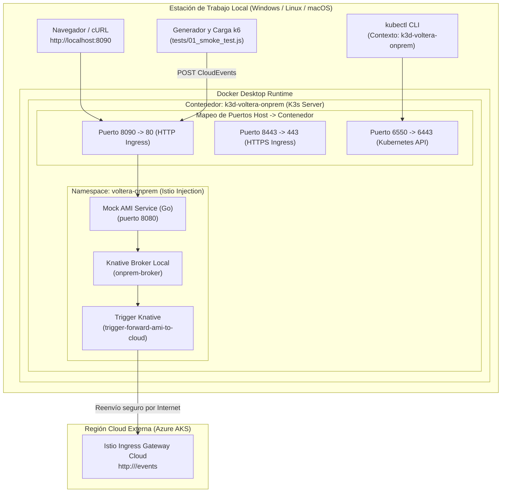
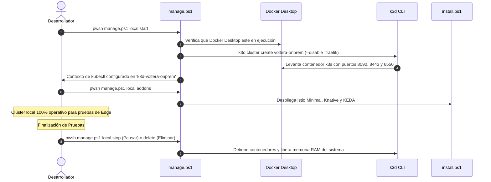

# Entorno Local K3s (k3d en Docker) para Simulación Edge / On-Premise

Este módulo proporciona un entorno Kubernetes ligero (**K3s**) ejecutado localmente sobre **k3d dentro de Docker Desktop**, diseñado para:
1. **Simular la Región On-Premise / Edge**: Emular subestaciones y concentradores de medición avanzada (AMI) sin costo alguno en la nube.
2. **Desarrollo Desconectado**: Probar microservicios, el Service Mesh (Istio) y el Event Mesh (Knative) en tu estación de trabajo sin incurrir en consumo de créditos.

---

## 🏛️ 1. Arquitectura del Clúster Local en Docker

El clúster local deshabilita el ingress por defecto de K3s (Traefik) para ceder el control de puertos al **Istio Ingress Gateway**:



---

## ⚡ 2. Ciclo de Vida del Clúster Local



---

## 📋 3. Requisitos Previos

| Herramienta | Versión Recomendada | Comando de Instalación (Windows) |
|---|---|---|
| **Docker Desktop** | 4.30+ | [Descargar de docker.com](https://www.docker.com/products/docker-desktop/) |
| **k3d** | v5.6+ | `winget install k3d.k3d` |
| **kubectl** | v1.30+ | `winget install Kubernetes.kubectl` |
| **Helm** | v3.14+ | `winget install Helm.Helm` |

---

## 🚀 4. Guía Operativa

### Paso 1: Iniciar el Clúster Local
Desde la raíz del repositorio o dentro de `infra/`:
```powershell
pwsh .\infra\manage.ps1 local start
```
*El script creará o reactivará el clúster `voltera-onprem`, mapeará los puertos y configurará el contexto de `kubectl`.*

### Paso 2: Instalar los Addons (Istio + Knative + KEDA)
```powershell
pwsh .\infra\manage.ps1 local addons
```

### Paso 3: Desplegar el Emulador On-Premise
```powershell
kubectl apply -f mock-onprem/k8s/app.yaml
kubectl apply -f mock-onprem/k8s/trigger-to-cloud.yaml
```

### Paso 4: Detener o Destruir el Clúster Local
* **Para pausar el clúster** (conserva contenedores y estado sin consumir CPU/RAM):
  ```powershell
  pwsh .\infra\manage.ps1 local stop
  ```
* **Para eliminar el clúster completamente**:
  ```powershell
  pwsh .\infra\manage.ps1 local delete
  ```

---

## 🔌 5. Tabla de Puertos Mapeados

| Puerto en el Host (Tu PC) | Puerto en K3s | Función |
|---|---|---|
| **`8090`** | `80` (HTTP) | Entrada HTTP para el Ingress Gateway de Istio |
| **`8443`** | `443` (HTTPS) | Entrada segura HTTPS / mTLS |
| **`6550`** | `6443` (API Server) | Puerto de control para comandos `kubectl` |

---

## 📁 6. Archivos del Módulo

* [`setup-k3s.ps1`](file:///d:/uniandes_local/nuevagen/infra/local-k3s/setup-k3s.ps1): Script para crear/iniciar el clúster k3d con Traefik deshabilitado y puertos expuestos.
* [`teardown-k3s.ps1`](file:///d:/uniandes_local/nuevagen/infra/local-k3s/teardown-k3s.ps1): Script para pausar (`stop`) o destruir (`delete`) el clúster.
* [`README.md`](file:///d:/uniandes_local/nuevagen/infra/local-k3s/README.md): Este documento explicativo.
