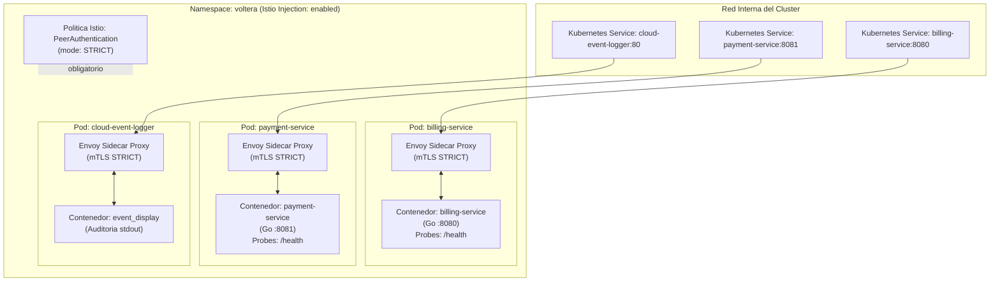
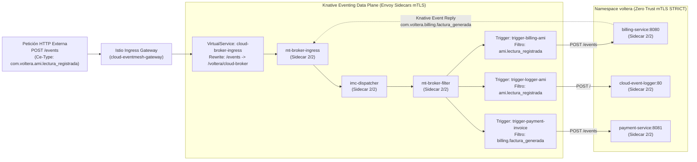
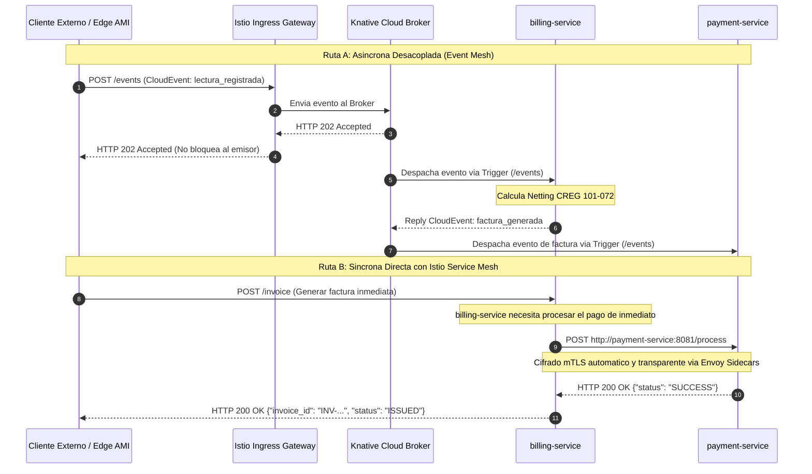

# Manifiestos de Kubernetes y Event Mesh (Región Cloud - AKS)

Esta carpeta contiene los manifiestos declarativos de Kubernetes para desplegar el núcleo transaccional de **Voltera** en la nube (Azure AKS o K3s), integrando **Istio Service Mesh** para seguridad Zero Trust y **Knative Eventing** para el enrutamiento desacoplado de CloudEvents.

---

## 🏛️ 1. Arquitectura de Despliegue y Seguridad Zero Trust

Todos los microservicios se despliegan en el namespace `voltera` con inyección automática de sidecar Envoy (`istio-injection: enabled`) y cifrado mutuo obligatorio (`PeerAuthentication mode: STRICT`):



---

## 📡 2. Topología de Knative Eventing en Kubernetes

El archivo `knative-event-mesh.yaml` orquesta el enrutamiento de eventos mediante un Broker central y Triggers filtrados:



---

## 🔄 3. Comparativa: Comunicación Asíncrona (Event Mesh) vs Síncrona (REST)



---

## 📋 4. Catálogo de Manifiestos

| Archivo | Tipo de Recurso(s) | Función Principal |
|---|---|---|
| [`namespace.yaml`](file:///d:/uniandes_local/nuevagen/k8s/namespace.yaml) | `Namespace` | Crea el espacio de nombres `voltera` y habilita `istio-injection: enabled`. |
| [`istio-auth-policy.yaml`](file:///d:/uniandes_local/nuevagen/k8s/istio-auth-policy.yaml) | `PeerAuthentication` | Fuerza mTLS estricto (`mode: STRICT`) en todo el tráfico del namespace. |
| [`knative-event-mesh.yaml`](file:///d:/uniandes_local/nuevagen/k8s/knative-event-mesh.yaml) | `Broker`, `Trigger`, `Gateway`, `VirtualService`, `Deployment`, `Service` | Define el Broker de la nube, los 3 Triggers de enrutamiento, el pod logger y la regla de Ingress. |
| [`billing.yaml`](file:///d:/uniandes_local/nuevagen/k8s/billing.yaml) | `Deployment`, `Service` | Despliega el microservicio de facturación con liveness y readiness probes en `/health`. |
| [`payment.yaml`](file:///d:/uniandes_local/nuevagen/k8s/payment.yaml) | `Deployment`, `Service` | Despliega el microservicio de pagos y pasarela con probes de salud en `:8081/health`. |

---

## 🚀 5. Instrucciones de Despliegue

### Aplicar los manifiestos en orden:
```powershell
# 1. Namespace con inyeccion de Istio
kubectl apply -f k8s/namespace.yaml

# 2. Politica Zero Trust (mTLS STRICT)
kubectl apply -f k8s/istio-auth-policy.yaml

# 3. Microservicios transaccionales
kubectl apply -f k8s/billing.yaml
kubectl apply -f k8s/payment.yaml

# 4. Capa de Event Mesh e Ingress
kubectl apply -f k8s/knative-event-mesh.yaml
```

### Verificar el estado del despliegue:
```powershell
# Verificar pods y sidecars inyectados (2/2 ready)
kubectl get pods -n voltera

# Verificar Broker y Triggers de Knative
kubectl get broker,trigger -n voltera

# Monitorear logs del Event Display Logger
kubectl logs -n voltera -l app=cloud-event-logger -f
```
