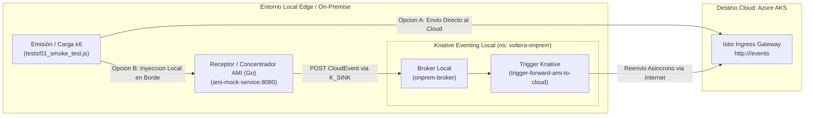
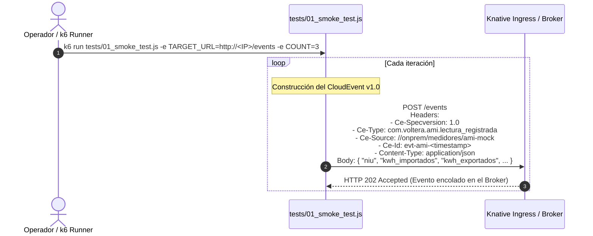

# Emulador Edge / On-Premise de Medición Avanzada (AMI)

Este módulo simula la infraestructura de **medición avanzada (AMI)** y recursos energéticos distribuidos (DERs) en el borde (*Edge* / subestaciones / hogares), cumpliendo con la **Resolución CREG 101-001 de 2022** en Colombia.

Proporciona dos componentes:
1. **Suite de Pruebas k6 (`tests/`)**: Generador y pruebas de carga de eventos **CloudEvents v1.0** (HTTP Binary Mode) con soporte para simulación individual, continua y concurrente.
2. **`main.go`**: Servicio en Go contenedorizado que emula un concentrador AMI en red local con reenvío asíncrono a Knative.

---

## 🏛️ 1. Arquitectura de la Región Edge y Reenvío al Cloud



---

## 📡 2. Diagrama de Secuencia de Emisión y Formato CloudEvents

El estándar de interoperabilidad adoptado es **CloudEvents v1.0 en modo HTTP Binary**, donde los metadatos viajan en encabezados `Ce-*` y los datos de telemetría en el cuerpo JSON:



---

## 💻 3. Guía de Uso de la Suite k6 (`tests/`)

Consulta la documentación completa en **[`tests/README.md`](../tests/README.md)**.

### 3.1 Ejemplos Rápidos de Ejecución

#### Enviar 5 lecturas al Ingress de Azure AKS (Paso 01):
```powershell
k6 run tests/01_smoke_test.js -e TARGET_URL="http://<INGRESS_IP>/events" -e COUNT=5 -e SLEEP=0.5
```

#### Simular un prosumidor con alta generación solar (Paso 02):
```powershell
k6 run tests/02_prosumer_scenario.js `
  -e TARGET_URL="http://<INGRESS_IP>/events" `
  -e NIU="98234710" `
  -e COUNT=1 `
  -e KWH_IMPORT=2.5 `
  -e KWH_EXPORT=8.5
```

---

## 🐳 4. Despliegue del Emulador en Kubernetes Edge

Los manifiestos en [`mock-onprem/k8s/`](file:///d:/uniandes_local/nuevagen/mock-onprem/k8s) permiten levantar un concentrador local en K3s:

```powershell
# 1. Crear namespace y broker local onprem
kubectl apply -f mock-onprem/k8s/app.yaml

# 2. Configurar el trigger de reenvío automático al Cloud
# (Asegúrate de configurar la IP del Ingress en trigger-to-cloud.yaml)
kubectl apply -f mock-onprem/k8s/trigger-to-cloud.yaml

# 3. Verificar estado
kubectl get pods,broker,trigger -n voltera-onprem
```
