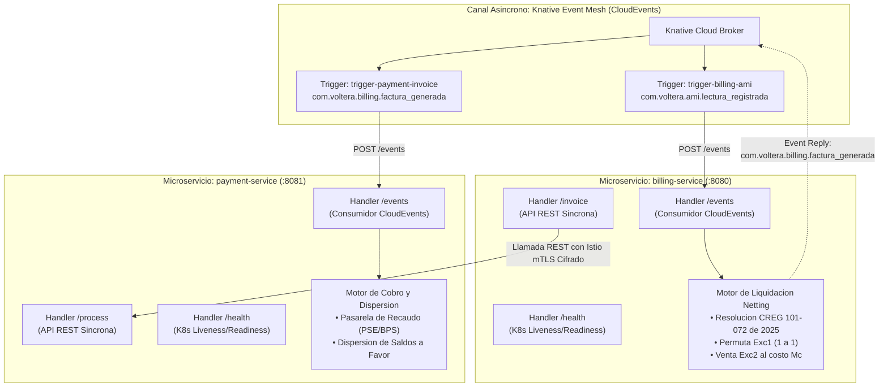
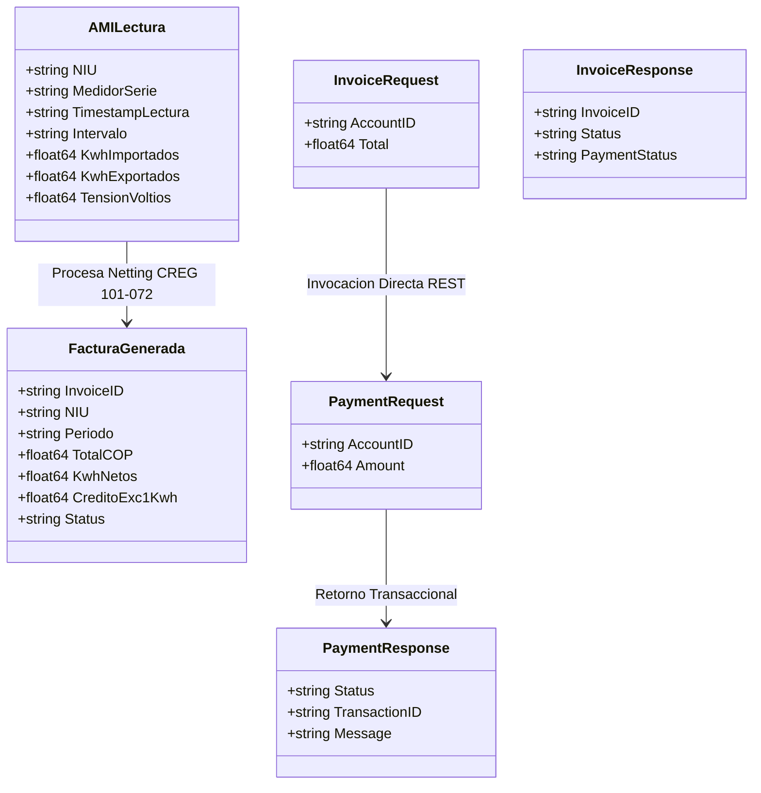

# Microservicios Transaccionales de Voltera (Go)

Este directorio aloja la implementación en **Go 1.22** de los microservicios transaccionales de **Voltera**, diseñados bajo una arquitectura orientada a eventos (**Event-Driven Architecture**) y preparados para operar dentro de un **Service Mesh (Istio)** con soporte dual para invocaciones síncronas REST y asíncronas vía **CloudEvents v1.0**.

---

## 🏛️ 1. Arquitectura de Servicios y Canales de Comunicación



---

## 📊 2. Modelos de Datos y Estructuras (Go Types)



---

## ⚡ 3. Endpoints Expuestos por los Microservicios

### 3.1 `billing-service` (Puerto :8080)
* **`POST /events`**: Endpoint para recepción de CloudEvents desde Knative (`com.voltera.ami.lectura_registrada`).
  - Aplica la fórmula de Netting:
    $$\text{NetKWh} = \text{KwhImportados} - \text{KwhExportados}$$
  - Si $\text{NetKWh} > 0$, liquida a tarifa estándar (850 COP/kWh).
  - Si $\text{NetKWh} \le 0$, aplica cargo mínimo de comercialización ($C_v$).
  - Emite automáticamente el CloudEvent `com.voltera.billing.factura_generada` como respuesta al Broker (Knative Eventing Reply pattern).
* **`POST /invoice`**: Endpoint REST tradicional síncrono. Emite una factura e invoca directamente a `payment-service:8081/process` a través del sidecar de Istio con mTLS.
* **`GET /health`**: Endpoint de diagnóstico de salud (`{"status": "healthy"}`).

### 3.2 `payment-service` (Puerto :8081)
* **`POST /events`**: Endpoint para recepción de CloudEvents de facturas emitidas (`com.voltera.billing.factura_generada`). Simula el cobro bancario o dispersión masiva de fondos al prosumidor.
* **`POST /process`**: Endpoint REST síncrono para procesar pagos bajo demanda.
* **`GET /health`**: Probe de salud para Kubernetes.

---

## 🐳 4. Compilación y Ejecución Local

Para compilar y correr localmente los servicios:
```powershell
# Iniciar payment-service
cd src\services\payment-service
go run main.go

# En otra terminal, iniciar billing-service
cd src\services\billing-service
go run main.go
```
