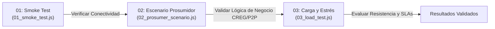

# 🧪 Suite de Pruebas de Event Mesh y Telemetría AMI (k6)

Esta carpeta contiene la suite de pruebas automatizadas y ordenadas por fases de ejecución para validar el flujo de eventos **CloudEvents v1.0 (HTTP Binary Mode)** hacia el Ingress de Azure AKS, el Broker de Knative Eventing o el concentrador local.

---

## 🗂️ Orden de Ejecución de las Pruebas



| Orden | Archivo | Tipo de Prueba | Descripción |
| :---: | :--- | :--- | :--- |
| **01** | **[`01_smoke_test.js`](01_smoke_test.js)** | **Humo y Conectividad** | Emite una lectura individual o un lote secuencial para verificar que el broker/ingress recibe y acepta los encabezados y payload CloudEvent. |
| **02** | **[`02_prosumer_scenario.js`](02_prosumer_scenario.js)** | **Escenario de Negocio** | Simula prosumidores solares con excedentes de energía inyectada ($Export > Import$) para probar reglas de liquidación CREG y P2P. |
| **03** | **[`03_load_test.js`](03_load_test.js)** | **Carga y Resistencia** | Genera múltiples medidores concurrentes (VUs) en etapas escalonadas para medir latencia, volumen total y tasas de error. |
| **04** | **[`04_idempotency_test.js`](04_idempotency_test.js)** | **Idempotencia** | Test del experimento de idempotencia: envía 1000 eventos (900 únicos + 100 duplicados) para validar deduplicación. |
| **--** | **[`utils.js`](utils.js)** | **Módulo Compartido** | Constructores de payload AMI, valores aleatorios y encabezados `Ce-*` estándar. |

---

## 🚀 Guía de Ejecución Paso a Paso

### Paso 01: Prueba de Humo y Conectividad (`01_smoke_test.js`)

Valida que el endpoint receptor esté activo y responda con códigos HTTP aceptados (`200 OK`, `201 Created` o `202 Accepted`).

#### 1.1 Emisión de una sola lectura (por defecto a `http://localhost:8080/events`):
```powershell
k6 run tests/01_smoke_test.js
```

#### 1.2 Emisión hacia el Ingress Gateway de Azure AKS:
```powershell
k6 run tests/01_smoke_test.js -e TARGET_URL="http://<INGRESS_IP>/events"
```

#### 1.3 Emisión de un lote de lecturas con intervalo de espera:
```powershell
# Envía 5 lecturas espaciadas por 0.5 segundos
k6 run tests/01_smoke_test.js `
  -e TARGET_URL="http://<INGRESS_IP>/events" `
  -e COUNT=5 `
  -e SLEEP=0.5
```

#### 1.4 Personalización de parámetros del medidor:
```powershell
k6 run tests/01_smoke_test.js `
  -e TARGET_URL="http://<INGRESS_IP>/events" `
  -e NIU="98234710" `
  -e KWH_IMPORT="15.20" `
  -e KWH_EXPORT="1.80" `
  -e TENSION_VOLTIOS="120.2"
```

---

### Paso 02: Escenario de Prosumidor Solar (`02_prosumer_scenario.js`)

Simula un usuario con paneles solares residenciales que genera más energía de la que consume, validando el flujo de liquidación de excedentes (*netting* según CREG 101-072 / CREG 101-001).

```powershell
# Enviar 5 lecturas de prosumidor con alta inyección
k6 run tests/02_prosumer_scenario.js `
  -e TARGET_URL="http://<INGRESS_IP>/events" `
  -e NIU="98234710" `
  -e COUNT=5
```

---

### Paso 03: Prueba de Carga Masiva y Estrés (`03_load_test.js`)

Evalúa la estabilidad y latencia del broker bajo ráfagas concurrentes de múltiples medidores inteligentes.

#### 3.1 Ejecución con rampa escalonada predeterminada:
* **0 a 15s**: Ramp-up hasta 10 medidores concurrentes.
* **15s a 45s**: Carga sostenida con 25 medidores concurrentes.
* **45s a 60s**: Pico de estrés con 50 medidores concurrentes.
* **60s a 70s**: Ramp-down a 0.

```powershell
k6 run tests/03_load_test.js -e TARGET_URL="http://<INGRESS_IP>/events"
```

#### 3.2 Modificación de concurrencia y tiempo al vuelo:
```powershell
# 100 medidores virtuales concurrentes durante 1 minuto continuo
k6 run --vus 100 --duration 1m tests/03_load_test.js -e TARGET_URL="http://<INGRESS_IP>/events"
```

---

---

### Paso 04: Test de Idempotencia (`04_idempotency_test.js`) 🎯

**Objetivo**: Validar que el sistema procesa eventos únicos una sola vez, rechazando duplicados automáticamente.

Este test es parte del **Experimento de Idempotencia** y simula:
- 90% de eventos únicos (900 eventos)
- 10% de eventos duplicados (100 eventos con `match_id` repetidos)
- Total: 1000 eventos enviados

#### 4.1 Ejecución con script automatizado (Recomendado):
```bash
# El script maneja todo: limpieza + test + validación
./scripts/idempotency/demo-idempotency.sh
```

#### 4.2 Ejecución manual del test:
```bash
# Prerequisito: match-processor debe estar corriendo
kubectl port-forward -n voltera svc/match-processor 8090:8080

# Ejecutar test en otra terminal
k6 run tests/04_idempotency_test.js \
  -e TARGET_URL="http://localhost:8090/events" \
  -e TOTAL=1000
```

#### 4.3 Validación de resultados:
```bash
# Verificar que NO hay duplicados en DB (debe retornar 0 rows)
POSTGRES_POD=$(kubectl get pod -n voltera -l app=postgres-matches -o jsonpath='{.items[0].metadata.name}')

kubectl exec -n voltera $POSTGRES_POD -- psql -U voltera -d voltera_matches -c "
SELECT match_id, COUNT(*) as count 
FROM matches 
GROUP BY match_id 
HAVING COUNT(*) > 1;
"

# Esperado: (0 rows) ✅
```

#### 4.4 Variables configurables:
| Variable | Descripción | Valor por Defecto |
| :--- | :--- | :--- |
| `TARGET_URL` | URL del servicio match-processor | `http://localhost:8090/events` |
| `TOTAL` | Total de eventos a enviar | `1000` |
| `DUPLICATE_RATE` | Porcentaje de duplicados (0.0-1.0) | `0.10` (10%) |

#### 4.5 Métricas custom del test:
- `test_unique_sent`: Contador de eventos únicos enviados
- `test_duplicates_sent`: Contador de eventos duplicados enviados

**Criterios de éxito**:
- ✅ 1000 eventos enviados (900 únicos + 100 duplicados)
- ✅ 900 registros únicos en tabla `matches`
- ✅ 1000 registros en tabla `processed_events`
- ✅ 0 duplicados en base de datos
- ✅ Efectividad de idempotencia: 90%

**Documentación completa**: [../docs/IDEMPOTENCY_EXPERIMENT.md](../docs/IDEMPOTENCY_EXPERIMENT.md)

---

## ⚙️ Tabla de Variables de Entorno Configurables

Todas las variables se configuran mediante el argumento `-e NOMBRE=VALOR` al ejecutar `k6 run`:

| Variable | Script Aplicable | Descripción | Valor por Defecto |
| :--- | :---: | :--- | :--- |
| `TARGET_URL` | Todos | URL del Ingress, Broker o servicio local | `http://localhost:8080/events` |
| `COUNT` | `01`, `02` | Número de eventos/iteraciones a emitir | `1` en 01 / `5` en 02 |
| `SLEEP` | `01` | Segundos de pausa entre iteraciones consecutivas | `1.0` |
| `NIU` | `01`, `02` | Número de Identificación de Usuario del medidor | `1002345` en 01 / `98234710` en 02 |
| `EVENT_TYPE` | `01`, `03` | Tipo de CloudEvent (`Ce-Type`) | `com.voltera.ami.lectura_registrada` |
| `EVENT_SOURCE`| `01`, `03` | Origen del evento (`Ce-Source`) | `//onprem/medidores/ami-mock` |
| `KWH_IMPORT` | `01`, `02` | Valor fijo de kWh importados | Aleatorio realista |
| `KWH_EXPORT` | `01`, `02` | Valor fijo de kWh exportados | Aleatorio realista |
| `TENSION_VOLTIOS` | `01` | Tensión de red medida en voltios | Aleatorio (118.0 - 122.0) |

---

## 📊 Umbrales de Calidad (*Thresholds*)

Las pruebas fallarán automáticamente si no se cumplen los siguientes SLAs:
* **`http_req_failed` < 1%**: Menos del 1% de solicitudes con fallos o códigos HTTP inesperados.
* **`http_req_duration` p(95) < 500ms**: El 95% de los eventos deben ser procesados en menos de 500 milisegundos.
* **Validación de estado HTTP**: Solo se consideran exitosos los códigos `200`, `201` y `202` (estándar de recepción asíncrona de Knative).
